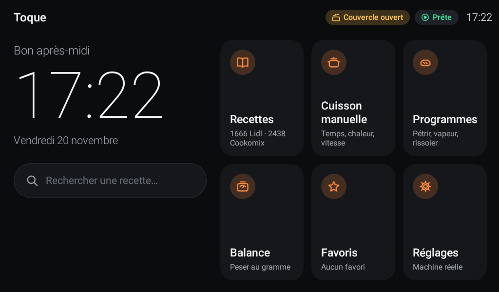
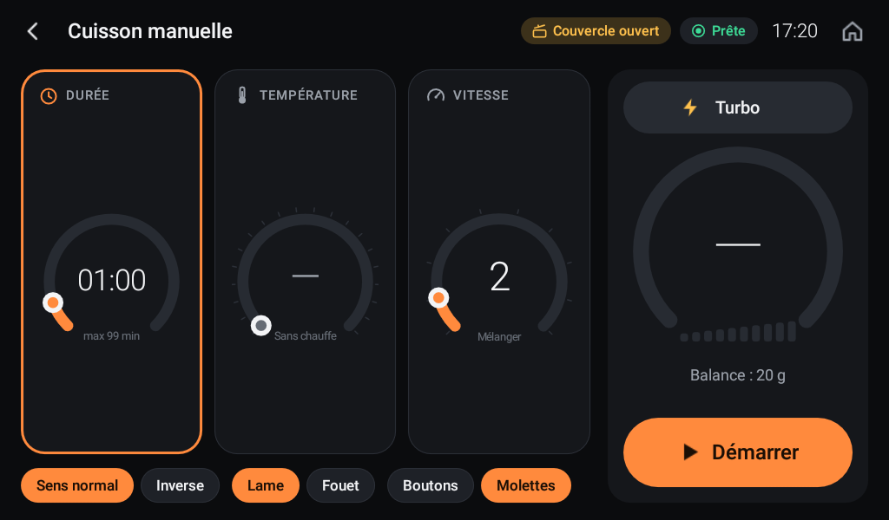
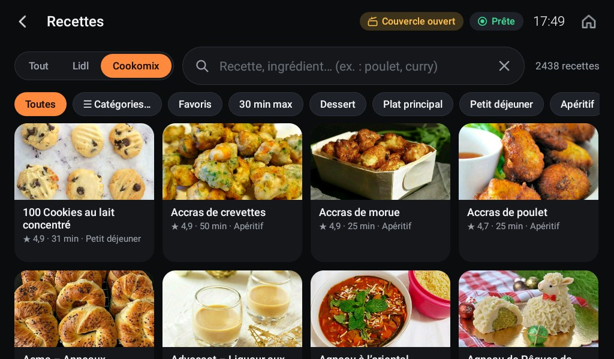
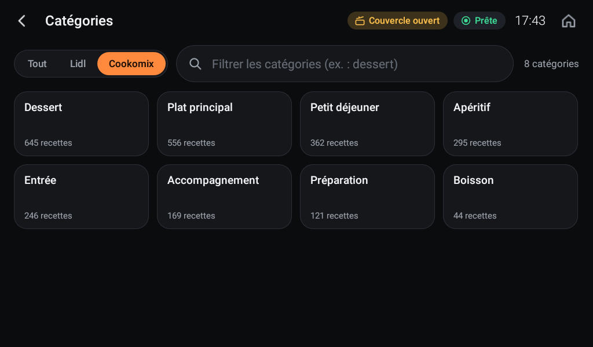
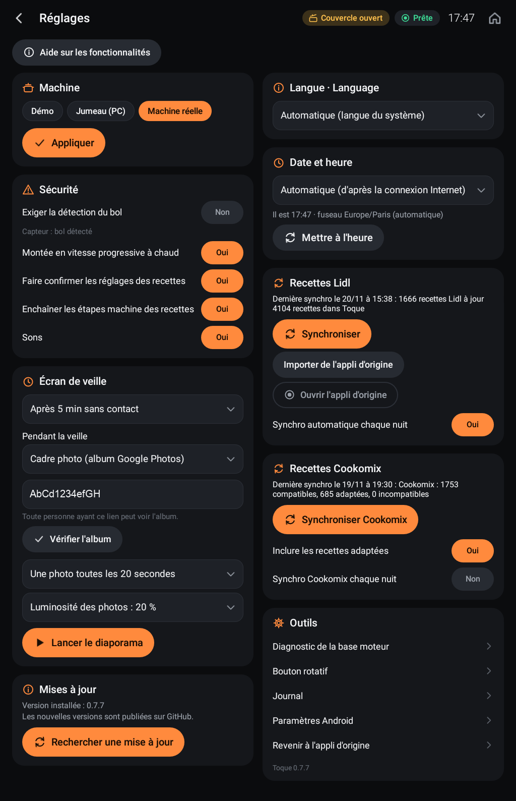
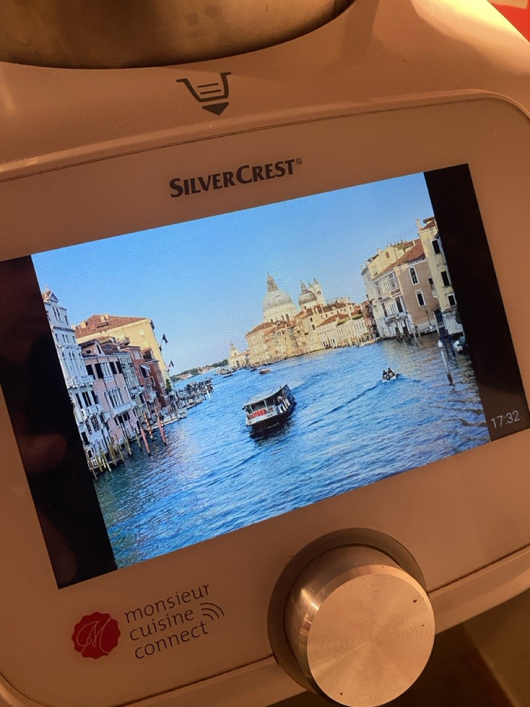
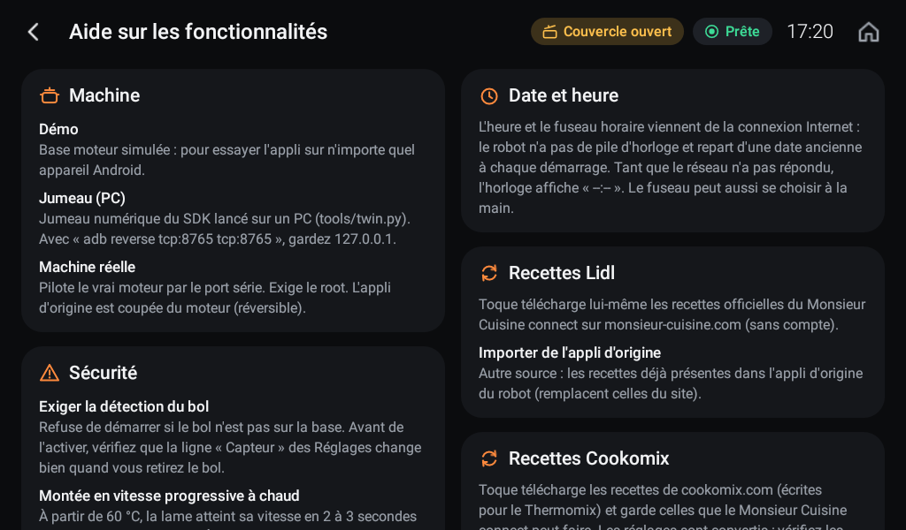

# MrCuisineVibeConnect

🇬🇧 **[English version](README.md)**

> **Version macOS.** Ceci est une copie de [Wuki60/MrCuisineVibeConnect](https://github.com/Wuki60/MrCuisineVibeConnect)
> dont les outils d'installation tournent sur un **Mac** : des scripts shell au lieu de PowerShell,
> et [mtkclient](https://github.com/bkerler/mtkclient) au lieu de SP Flash Tool et de son pilote
> Windows. L'appli Toque est inchangée et se met toujours à jour depuis les versions du dépôt
> d'origine. L'installation depuis macOS a été faite de bout en bout sur un vrai robot en
> novembre 2026 ; voir [AGENTS.md](AGENTS.md).

**Toque**, une interface moderne et rapide pour le robot **Monsieur Cuisine Connect** (SKMC 1200),
qui remplace l'appli d'origine sur la tablette du robot tout en gardant **les recettes Lidl**.

> Projet indépendant, non affilié à Lidl, SilverCrest ni Hoyer. Le pilotage du moteur repose
> sur une analyse publique du protocole ; il tourne au quotidien sur un robot (SKMC 1200, Android 6)
> depuis octobre 2026 et sur un second depuis novembre 2026, mais n'a pas été essayé sur d'autres.
> À utiliser à vos risques, en suivant la procédure de premier essai.

## Installer

**Commencez ici : [docs/INSTALLATION.fr.md](docs/INSTALLATION.fr.md)**, un guide pas à pas qui part
de zéro, pour Mac (et, [essayé une fois](docs/INSTALLATION.fr.md#8-depuis-un-pc-linux),
pour un PC Linux). Sous Windows, suivez le
[guide du dépôt d'origine](https://github.com/Wuki60/MrCuisineVibeConnect/blob/main/docs/INSTALLATION.fr.md).

En bref : il faut un Mac, un câble **USB-A mâle ↔ USB-A mâle**, un petit tournevis Torx et 1 à 2
heures. Vous préparez le Mac (Homebrew, puis une copie de ce dépôt), puis soit vous laissez
[Claude Code](https://code.claude.com/docs/en/quickstart) faire l'installation en suivant
[AGENTS.md](AGENTS.md), soit vous lancez vous-même [`tools/setup/toque-setup.sh`](tools/setup/toque-setup.sh),
une étape à la fois. Il sauvegarde d'abord le robot, le roote avec Magisk, installe Toque et active
ADB par Wi-Fi. Vous ne vous occupez que de la trappe, du câble, de l'interrupteur et d'un appui sur
l'écran du robot.

## Captures d'écran

Prises sur un robot (SKMC 1200, écran de 1024 × 600).

| Accueil | Cuisson manuelle (molettes) |
|---|---|
|  |  |
| **Recettes (onglet Cookomix)** | **Catégories (onglet Cookomix)** |
|  |  |
| **Réglages (la page entière)** | **Cadre photo pendant la veille** |
|  |  |
| **Aide sur les fonctionnalités** | |
|  | |

## Ce que fait Toque

- **Interface sombre**, pensée pour l'écran 7" et le bouton rotatif du robot, fluide sur sa
  tablette d'origine (1 Go de RAM, Android 6) : pas de bibliothèque lourde, images
  sous-échantillonnées, vues recyclées.
- **Recettes Lidl, directement depuis monsieur-cuisine.com**. Toque télécharge les recettes
  officielles du Monsieur Cuisine connect (environ 1 700 en français, avec les réglages machine de
  chaque étape) par l'API publique du site, chaque nuit ou sur demande : aucun compte, aucun
  serveur à gérer, plus besoin de l'appli d'origine. Requêtes espacées, et seules les recettes
  nouvelles ou modifiées sont retéléchargées. On peut toujours importer à la place celles de
  l'appli d'origine.
- **Recettes Cookomix** : Toque lit les recettes de [cookomix.com](https://www.cookomix.com) (écrites
  pour le Thermomix) sur les pages publiques du site et garde celles que le MCC peut faire, chaque
  réglage converti pour le MCC et contrôlé par les mêmes sécurités (détails plus bas).
- **Cuisson manuelle aux boutons ou aux molettes** : boutons − / + ou molettes tactiles (choix
  « Boutons / Molettes », mémorisé), avec les mêmes limites de sécurité ; pendant la cuisson, un
  cran par geste. Turbo est en haut du panneau de droite, loin de Démarrer.
- **Mise en veille de l'écran** : après 5, 10 (par défaut) ou 30 min sans contact, écran noir avec
  l'heure et la date, luminosité au minimum, ou **cadre photo** : les photos d'un album Google
  Photos partagé par lien, dans un ordre mélangé, avec un fondu entre elles (Réglages › Écran de
  veille : le lien de l'album, 10 à 60 secondes par photo, sa propre luminosité) ; le bouton
  rotatif passe à la photo suivante ou précédente. Les photos sont lues en ligne à la taille de
  l'écran et jamais enregistrées sur le robot ; les vidéos sont écartées. Toute personne qui a le
  lien peut voir l'album, et Google ne documente pas la page que lit Toque : si elle change, la
  veille revient à l'heure. Jamais pendant un programme, une alerte ou une synchro de recettes.
- **Une barre d'état qui dit ce que voit la base** : couvercle ouvert ou **bol retiré**,
  température du bol dès que la base en mesure une (elle n'en donne pas à froid), liaison avec la
  base ; grands boutons Retour et Accueil.
- **Page Réglages courte** : les commandes et les états seulement ; les explications sont dans une
  page *Aide sur les fonctionnalités*, ouverte depuis le haut des Réglages.
- **Confirmation des réglages au choix** : *Réglages › Sécurité › Faire confirmer les réglages des
  recettes* (activée par défaut) ; désactivée, les réglages hors limites restent refusés.
- **Recettes par source** : onglets Tout / Lidl / Cookomix (mémorisés) et page « Catégories… »
  avec toutes les catégories et leur nombre de recettes ; sur l'accueil, une croix oublie la recette
  commencée.
- **Auteur, notes et avis** : chaque recette affiche qui l'a publiée et sa note sur le site, et la
  fiche charge les commentaires des utilisateurs (avec les réponses de Monsieur Cuisine).
- **Recherche qui marche** : insensible aux accents, aux pluriels et aux fautes de frappe
  (« bechamle », « risoto »). Recherche par ingrédients (« poulet, curry »), filtres, favoris.
  L'index de recherche est enregistré : les 4 000 recettes sont là une à deux secondes après le
  démarrage, et un favori apparaît tout de suite.
- **Cuisine pas à pas** : chaque étape se lance d'un appui, l'étape suivante s'affiche toute
  seule, pesée intégrée, reprise après coupure. Les réglages qui se suivent sans geste à faire
  entre eux (rinçage, mixages en plusieurs vitesses…) partent ensemble d'un seul appui : la lame
  passe directement d'une vitesse et d'une température à l'autre, sans s'arrêter.
- **Cuisson manuelle**, programmes **Pétrir / Vapeur / Rissoler**, **Turbo**, **balance**.
- **Hors ligne** : tout fonctionne sans réseau (plus de « serveur injoignable » au démarrage).
- **Heure toujours juste** : l'heure et le fuseau horaire viennent de la connexion Internet (le
  robot n'a pas de pile d'horloge) ; le fuseau peut se choisir à la main dans Réglages › Date et
  heure. Après un démarrage, l'horloge est remise à la dernière heure connue, puis réglée par le
  réseau ; d'ici là elle affiche `--:--` plutôt qu'une heure fausse.
- **Pensé pour un robot sans boutons Android** : Toque s'ouvre au démarrage, et un bouton
  **« Retour à Toque »** reste affiché par-dessus l'appli d'origine quand on l'ouvre.
- **Mises à jour depuis GitHub** : Réglages › Mises à jour vérifie les
  [versions publiées](https://github.com/Wuki60/MrCuisineVibeConnect/releases) de ce dépôt et installe
  la nouvelle (sans rien demander sur un robot rooté, puis Toque redémarre). Refusé pendant un programme.

## Recettes Cookomix

Cookomix n'a pas d'API ouverte : Toque lit les pages publiques du site, depuis le robot. La liste
des recettes vient des sitemaps, et chaque page contient le pas-à-pas Cookomix avec des réglages
structurés (durée, °C, vitesse, sens inverse, pétrin, Varoma, accessoires). Chaque réglage
Thermomix est converti pour le MCC dans
[`Cookomix.kt`](core/src/main/kotlin/app/toque/core/recipes/Cookomix.kt) :

| Thermomix | Monsieur Cuisine Connect |
|---|---|
| vitesse cuillère (codée 0) ou 0,5 | vitesse 1, la plus lente du MCC (les recettes Lidl mijotent aussi en vitesse 1 inverse) |
| demi-vitesse (3,5) | arrondie au-dessus (4), recette « adaptée » |
| température hors table (98 °C) | palier inférieur du MCC (95 °C), recette « adaptée » |
| Varoma | 120 °C en manuel, même vitesse (le programme Vapeur du MCC arrête la lame et s'arrête à 60 min) |
| « Rissoler » 120 °C vitesse 1 | 120 °C en manuel, vitesse 1 en continu |
| vitesse > 3 en chauffe ou en sens inverse | vitesse 3, recette « adaptée » |
| fouet (étapes « ajouter l'accessoire » et texte des étapes) | vitesse 4 au plus, pas de Turbo avec le fouet |
| pétrin | programme Pétrir, en tranches de 2 min |
| durée > 99 min | découpée en plusieurs lancements |
| plus de 130 °C, vitesse ou mode sans équivalent, accessoire inconnu | recette **incompatible**, non importée |

Sur toutes les recettes du site (2 437, novembre 2026) : 1 752 compatibles telles quelles, 685
adaptées, 0 incompatible. Les recettes adaptées portent le mot-clé « Adaptée MCC » et expliquent
dans leurs notes ce qui a changé. Comme pour les recettes Lidl, chaque réglage importé est confirmé
avant d'être lancé (sauf si cette option est désactivée).

*Réglages › Recettes Cookomix › Synchroniser Cookomix* : une heure ou plus la première fois (une
page toutes les 1 à 2 secondes, photos comprises), puis seulement les recettes nouvelles ou
modifiées. Les recettes apparaissent pendant la synchro. Options : inclure les recettes adaptées
(activé par défaut) et synchro chaque nuit (désactivée par défaut). Une synchro interrompue par une
coupure ou une mise à jour reprend toute seule au démarrage (les deux synchros, 3 fois de suite au
plus). Si le site est en panne ou change de format, la synchro s'arrête avec un code d'erreur
(CKX-01 à CKX-07, [docs/COOKOMIX-ERREURS.md](docs/COOKOMIX-ERREURS.md)) et ne supprime aucune recette
enregistrée. Les recettes restent la propriété de Cookomix et de leurs auteurs : chaque robot les
télécharge pour l'usage personnel de son propriétaire ; chaque recette garde son auteur, sa note et
le lien vers sa page d'origine.

## Sécurité : ce qui change par rapport à l'appli d'origine

Toutes les limites d'origine sont reprises (vitesse 3 maximum en chauffe et en sens inverse,
durées maximales, conditions du Turbo…). Plusieurs défauts relevés par l'analyse du protocole
sont corrigés :

| Défaut de l'appli d'origine | Toque |
|---|---|
| Le démarrage était demandé avant de vérifier le couvercle | Couvercle, erreurs et fraîcheur des mesures sont vérifiés **avant** tout démarrage |
| Aucune détection d'une base moteur muette | Plus de réponse pendant 1,5 s : tout s'arrête et une alerte s'affiche |
| Erreurs d'écriture série ignorées | Arrêt et alerte |
| Un STOP suivi d'un START pouvait ne jamais émettre d'arrêt | Tout redémarrage ou changement de sens attend un échantillon confirmant **moteur arrêté** |
| Lecture série sans resynchronisation | Trames fragmentées, collées ou corrompues gérées |
| La lame tournait parfois en vapeur | Vapeur à vitesse 0 |

Autres ajouts : confirmation (et montée progressive) avant de mixer un contenu à 60 °C ou plus,
limite de vitesse avec le fouet, alertes verrouillées jusqu'à acquittement, rien ne redémarre
tout seul après une pause ou une alerte. À froid, la lame va directement à la vitesse demandée. Le pilotage tourne dans **son propre processus** : un plantage de l'interface ne coupe
pas une cuisson, qui se termine normalement.

## Structure

```
core/   Logique pure Kotlin, testée sans Android
        protocol/  trames série (15 octets émis, 27 reçus, 4800 bauds)
        machine/   règles de sécurité, contrôleur, boucle 100 ms, liaisons (série root, TCP, démo)
        recipes/   modèle, import de la base d'origine, recherche, conversion Cookomix → MCC
        photos/    lecture d'un album Google Photos partagé par lien (cadre photo)
app/    Appli Android (minSdk 23), sans AndroidX
        machine/   service de pilotage (processus « :machine ») et IPC
        recipes/   catalogue local, synchros Lidl et Cookomix
        ui/        écrans
tools/  setup/toque-setup.sh (installation complète depuis un Mac, pilotable par un agent IA), robot/
        (scripts lancés sur le robot : root, écriture depuis TWRP, restauration), scripts
        d'installation, de restauration et de publication (.sh pour macOS, les .ps1 d'origine pour
        Windows), twin.py (jumeau numérique pour tester)
docs/   INSTALLATION.md (EN), INSTALLATION.fr.md (FR), COOKOMIX-ERREURS.md (codes d'erreur Cookomix)
AGENTS.md  procédure d'installation pour un agent IA
```

## Compiler

Ouvrir le dossier dans **Android Studio**, attendre la synchronisation Gradle, puis
**Build › Build App Bundle(s) / APK(s) › Build APK(s)**. L'APK est dans
`app/build/outputs/apk/debug/`.

En ligne de commande : `./gradlew assembleDebug` (et `./gradlew :core:test` pour les tests). Gradle
demande le JDK 17 ou 21 ; avec un JDK par défaut plus récent, la compilation s'arrête avec un simple
numéro de version comme erreur. Le JDK d'Android Studio convient :
`export JAVA_HOME="/Applications/Android Studio.app/Contents/jbr/Contents/Home"`.

## Tester sans le robot

1. **Mode Démo** (par défaut) : installer l'APK sur n'importe quel Android (ou l'émulateur
   d'Android Studio, en paysage). La base moteur est simulée ; Réglages › Outils › Diagnostic
   permet d'ouvrir le couvercle ou de provoquer une erreur pour voir les sécurités.
   Réglages › Recettes Lidl › Synchroniser télécharge les recettes sur n'importe quel appareil.
2. **Jumeau numérique** : le jumeau du [Monsieur Cuisine Developer SDK](https://github.com/antrea/monsieur-cuisine-developer-sdk)
   reproduit le protocole réel indépendamment de Toque.
   `python3 tools/twin.py --sdk <dossier du SDK>` puis, dans Toque, Réglages › Machine ›
   Jumeau (émulateur : hôte `10.0.2.2` ; appareil réel : `adb reverse tcp:8765 tcp:8765` et
   hôte `127.0.0.1`). `python3 tools/twin.py --send "lid 1"` ouvre le couvercle, etc. Avec le
   jumeau lancé, `./gradlew :core:test` exécute aussi `TwinIntegrationTest` et `CookomixTwinTest`,
   qui envoie chaque réglage converti d'une recette Cookomix au jumeau et vérifie que les réglages
   hors limites du MCC sont refusés avant d'atteindre la base.

## Ajouter une langue

L'appli est écrite en français ; chaque autre langue est un fichier dans
[`app/src/main/assets/lang/`](app/src/main/assets/lang) (`en.json` pour l'anglais).

1. Copier `en.json` en `<code>.json` (par exemple `de.json`), mettre `"_name"` (par exemple `"Deutsch"`)
   et traduire les valeurs. Les clés sont les textes français ; garder les `%s` / `%d`.
   Les textes manquants restent en français.
2. Recompiler l'appli, ou, sans recompiler, copier le fichier dans `Android/data/app.toque/files/lang/`
   sur l'appareil puis relancer Toque.

La langue apparaît alors dans Réglages › Langue · Language. `./gradlew :core:test` vérifie chaque
fichier de langue.

## Publier une nouvelle version

1. Augmenter `versionCode` et `versionName` dans `app/build.gradle.kts`.
2. Committer et pousser sur `main`.

Le [workflow de publication](.github/workflows/release.yml) lance les tests, compile l'APK et publie la
version `vX.Y.Z` avec. Les robots la trouvent ensuite dans Réglages › Mises à jour.

Toutes les compilations sont signées avec la clé du projet (`app/signature/`, publique exprès) : un APK
compilé sur n'importe quel PC ou par GitHub s'installe par-dessus la version précédente. N'installez que
les APK publiés sur ce dépôt.

Sans GitHub Actions : `./gradlew assembleRelease`, puis
`bash tools/publish-release.sh --apk app/build/outputs/apk/release/app-release.apk [--repo propriétaire/nom]`
crée la version `vX.Y.Z` et y joint l'APK (il faut `gh` ; jeton GitHub : `GH_TOKEN`, `gh auth login`,
ou les identifiants déjà enregistrés pour git ; `--dry-run` montre seulement ce qu'il ferait).

## Installer sur le robot

**[docs/INSTALLATION.fr.md](docs/INSTALLATION.fr.md)** (voir [Installer](#installer)) : préparation
du Mac, root, installation avec Claude Code ou à la main, premier essai à vide, synchronisation des
recettes, retour à l'appli d'origine. Depuis Windows, suivre le guide du dépôt
d'origine.

## Crédits

- Protocole : [Monsieur Cuisine Developer SDK](https://github.com/antrea/monsieur-cuisine-developer-sdk) (MIT).
- Accès au robot : [Monsieur-Cuisine-Connect-Hack](https://github.com/EliasKotlyar/Monsieur-Cuisine-Connect-Hack).
- Mode téléchargement MediaTek sous macOS : [mtkclient](https://github.com/bkerler/mtkclient) (GPLv3, téléchargé par `prepare`, non inclus ; `prepare` applique les corrections pour le pilote série de macOS de `tools/setup/mtkclient-macos-serial.patch`).

Licence MIT. Ce dépôt ne contient aucune recette, image ni code de Lidl : chaque robot télécharge
lui-même les recettes sur monsieur-cuisine.com, pour l'usage personnel de son propriétaire.
